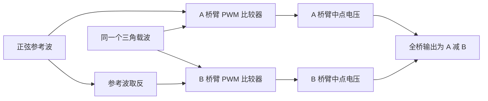

# 逆变调制策略

## NLM（最近电平调制）

用于多电平变换器。调制器为参考电压选择最接近的可用输出电平。

仿真示例：[三电平 NLM 调制器](../../04_仿真/03_DC-AC/谐振驱动/NLM3LFCNPC.slx)。

## PWM（脉冲宽度调制）

### SPWM（单相逆变）

#### 单极性调制

高频桥臂中点连接电感

两种方式的区别在于高频和低频开关任务如何分配给两个桥臂。

| 方式 | 桥臂角色 | 特点 |
| --- | --- | --- |
| 交替 | 两个桥臂交替承担高频和低频开关 | 器件发热更均匀 |
| 不交替 | 一个桥臂高频开关，另一个桥臂低频切换 | 高频桥臂损耗较集中 |

##### 交替

- 每个管都是高低频交替，发热均匀

- 每个桥臂的上下管极性相反

- 每个桥臂相对应的管子高低频相反

- 两个桥臂所连接的电感，磁路不耦合

$$
L=\frac{L_{\text{总}}}{2}
$$

两只电感磁路不耦合且电感量相等时，上式给出每只电感的取值。

提高功率器件利用率

*用于逆变器模式*

- **调制波上移法：**

  对系统延迟很小。

  上移调制波后与载波比较产生开关信号；具体偏置及切换逻辑取决于实现。

##### 不交替

- 各桥臂的损耗取决于器件和工况。
- 原笔记的器件搭配为低频桥臂用 MOSFET，高频桥臂用 GaN 或 SiC 器件。

高频桥臂负责 PWM，低频桥臂按输出电压的半周期切换。

常用于图腾柱PFC(PWM整流器)：一端接火线一端接零线

*用于PFC模式*

- **载波上移法：**

  $$
  N=\frac{f_c}{f_m}
  $$

  其中 $f_c$ 为载波频率， $f_m$ 为调制波频率。同步实现时可选整数载波比。数值精度和电源配置取决于具体控制器。

- **数据选择法：**
  可使用无符号整数（UINT）选择数据。具体电源配置取决于实现。

#### 双极型

桥输出在正、负直流母线电压之间切换。与单极性调制的谐波和开关损耗比较取决于具体设计。

#### 倍频

在这种单极性 SPWM 中，两个桥臂各自产生 PWM，桥输出为两桥臂中点电压之差。输出脉冲的等效开关频率是载波频率的两倍，输出基波频率由正弦调制波决定。

- **调制波倒相法：**

  两个桥臂分别比较相反的正弦调制波与载波。

- **载波倒相法：**
  使用反相载波时，需要保证两路载波的同步和相位关系，可由具备相应功能的 PWM 外设实现。

下图是调制波倒相法的信号关系。

单相桥和单极性 SPWM 的电路及波形可参见 [IIT Delhi 虚拟实验室](https://pe1-iitd.vlabs.ac.in/exp/single-phase-sinusoidal-pwm/theory.html)。

### SVPWM（三相逆变）

SVM 与 DPWM 的相电压参考波形对比见论文 [Influence of Inverter Modulation Strategy on Electric Drive Efficiency and Perceived Sound Quality](https://doi.org/10.1109/TTE.2015.2514162) 的图 1。

仿真示例：[DPWM 模型](../../04_仿真/09_控制与信号处理/DPWM/dpwm.slx)。

#### 七段式（CPWM）

马鞍波

原笔记提到低速应用。调制方式的选择及开关损耗仍需结合运行工况。

#### 五段式（DPWM）

羊角波的一种钳位区间示例

- 0°~60°：高频开关
- 60°~120°：高电平（低频）
- 120°~180°：高频开关

1. 将钳位区间与较大电流区间匹配，可减少开关损耗。效果取决于调制方式和负载。
2. 钳位期间对应桥臂减少高频切换。共模噪声还取决于电路和调制策略。
